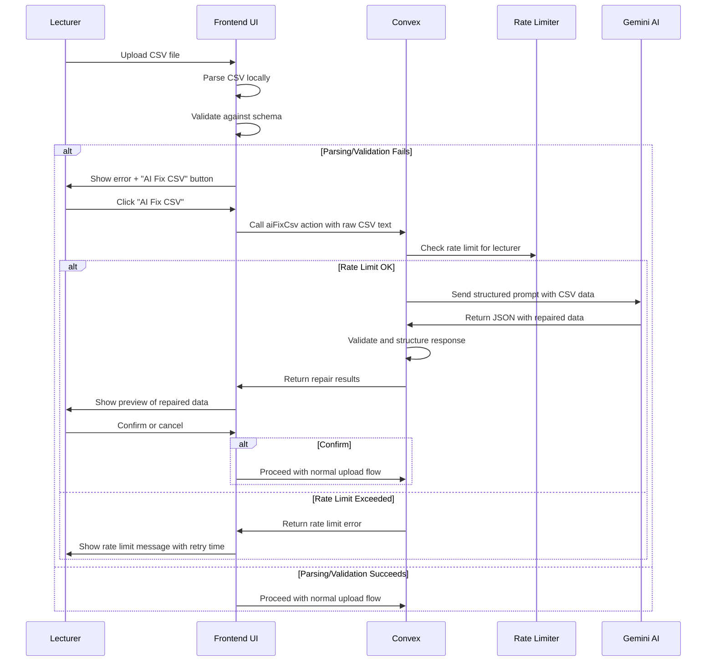

# Design Document

## Overview

The AI CSV Fix feature enhances ClassSync's student list upload functionality by providing an intelligent fallback mechanism when CSV parsing fails. The system uses Google's Gemini AI through Convex Actions to automatically repair malformed CSV files, normalize data, and map non-standard headers to the expected schema format.

## Architecture

### High-Level Flow



### System Components

1. **Frontend CSV Handler**: Enhanced upload component with AI fix integration
2. **Convex Action**: `aiFixCsv` action that interfaces with Gemini AI
3. **Rate Limiter**: Convex rate limiter component for API usage control
4. **Prompt Builder**: Utility to construct effective Gemini prompts
5. **Schema Validator**: Zod schemas for validation and type safety
6. **Preview Component**: UI for reviewing AI-repaired data

## Components and Interfaces

### 1. Convex Action Structure

**File**: `convex/actions/aiFixCsv.ts`

```typescript
interface AiFixCsvArgs {
  rawCsvText: string;
}

interface AiFixCsvResult {
  repaired: boolean;
  data?: ExpectedStudentSchema[];
  summary?: string;
  warnings?: string[];
  confidence?: number;
  error?: string;
  debug?: string;
}

interface ExpectedStudentSchema {
  name: string;
  gender: 'Male' | 'Female';
  regNumber: string;
}
```

### 2. Rate Limiter Configuration

**File**: `convex/convex.config.ts`

```typescript
import { defineApp } from 'convex/server';
import rateLimiter from '@convex-dev/rate-limiter/convex.config';

const app = defineApp();
app.use(rateLimiter);

export default app;
```

**Rate Limit Policies**:

```typescript
import { RateLimiter, MINUTE, HOUR } from '@convex-dev/rate-limiter';
import { components } from './_generated/api';

const rateLimiter = new RateLimiter(components.rateLimiter, {
  // AI CSV repair attempts per lecturer
  aiCsvFix: { kind: 'fixed window', rate: 5, period: HOUR },
  // Global AI service usage to prevent abuse
  aiServiceUsage: { kind: 'token bucket', rate: 100, period: HOUR, shards: 5 },
});
```

### 3. Prompt Builder

**File**: `convex/utils/buildPrompt.ts`

The prompt builder creates structured instructions for Gemini AI that include:

- Clear task definition
- Expected input/output format
- Header mapping rules
- Data normalization requirements
- Gender inference guidelines
- JSON response format specification

### 3. Schema Validation

**File**: `convex/schemas/studentSchema.ts`

Uses Zod to define and validate the expected student data structure:

- Name validation (non-empty string, proper formatting)
- Gender validation (strict enum: 'Male' | 'Female')
- Registration number validation (format requirements)

### 4. Frontend Integration

**Enhanced Upload Component**: Extends existing `StudentUploadSection` with:

- Error state handling for failed parsing
- AI Fix button integration
- Preview modal for repaired data
- Confidence score display
- Change summary presentation

## Data Models

### Input Data Model

```typescript
// Raw CSV text input
type RawCsvInput = string;

// Parsed but potentially malformed data
interface ParsedCsvRow {
  [key: string]: string | undefined;
}
```

### Processing Data Model

```typescript
// Header mapping configuration
interface HeaderMapping {
  detected: string;
  mapped: string;
  confidence: number;
}

// Processing metadata
interface ProcessingMetadata {
  headerMappings: HeaderMapping[];
  dataCorrections: string[];
  genderInferences: number;
  rowsProcessed: number;
  rowsExcluded: number;
}
```

### Output Data Model

```typescript
// Final validated student schema
interface ExpectedStudentSchema {
  name: string;
  gender: 'Male' | 'Female';
  regNumber: string;
}

// Complete repair result
interface RepairResult {
  repaired: boolean;
  data: ExpectedStudentSchema[];
  summary: string;
  warnings: string[];
  confidence: number;
  metadata: ProcessingMetadata;
}
```

## Error Handling

### Error Categories

1. **Network Errors**: Gemini API unavailable or timeout
2. **Parsing Errors**: Invalid JSON response from Gemini
3. **Validation Errors**: Repaired data doesn't match expected schema
4. **Business Logic Errors**: Confidence too low, too many warnings

### Error Recovery Strategy

```typescript
// Error handling hierarchy
try {
  // Call Gemini AI
  const geminiResponse = await callGeminiAPI(prompt);

  // Parse response
  const parsedData = JSON.parse(geminiResponse);

  // Validate against schema
  const validatedData = validateStudentData(parsedData);

  // Check confidence threshold
  if (confidence < 0.5) {
    return lowConfidenceWarning();
  }

  return successResult(validatedData);

} catch (networkError) {
  return networkErrorFallback();
} catch (parseError) {
  return parseErrorFallback(geminiResponse);
} catch (validationError) {
  return validationErrorFallback(parsedData);
}
```

### Fallback Mechanisms

- **Primary**: Show original parsing error with manual correction suggestions
- **Secondary**: Provide CSV template download

## Testing Strategy

### Unit Tests

1. **Prompt Builder Tests**
   - Verify prompt structure and formatting
   - Test with various CSV formats
   - Validate header mapping logic

2. **Schema Validation Tests**
   - Test valid and invalid student data
   - Verify error messages and validation rules
   - Test edge cases and boundary conditions

3. **Action Handler Tests**
   - Mock Gemini API responses
   - Test error handling scenarios
   - Verify response formatting

### Integration Tests

1. **End-to-End CSV Processing**
   - Test complete flow from upload to repair
   - Verify UI state transitions
   - Test with real malformed CSV files

2. **Gemini API Integration**
   - Test with actual API calls (in development)
   - Verify prompt effectiveness
   - Test rate limiting and error scenarios

### Performance Tests

1. **Large File Handling**
   - Test with CSV files containing 100+ students
   - Verify processing time limits
   - Test memory usage patterns

2. **Concurrent Processing**
   - Test multiple simultaneous repair requests
   - Verify system stability under load

## Security Considerations

### Data Protection

1. **Temporary Data Handling**
   - Raw CSV content not permanently stored
   - Automatic cleanup of processing artifacts
   - No logging of sensitive student information

2. **API Security**
   - Secure Gemini API key management
   - Request rate limiting
   - Input sanitization and validation

3. **Access Control**
   - Lecturer authentication required
   - Action restricted to authenticated users
   - Audit logging for repair operations

### Privacy Compliance

1. **Data Minimization**
   - Only necessary data sent to AI service
   - No persistent storage of repair attempts
   - Clear data retention policies

2. **Consent and Transparency**
   - Clear indication when AI processing is used
   - Option to decline AI repair
   - Transparency about data processing

## Performance Optimization

### Caching Strategy

1. **Header Mapping Cache**
   - Cache common header variations
   - Reduce AI processing for repeated patterns
   - Lecturer-specific mapping preferences

2. **Response Optimization**
   - Structured JSON responses
   - Minimal data transfer
   - Efficient validation algorithms

### Processing Limits

1. **File Size Limits**
   - Maximum CSV size: 1MB
   - Maximum student count: 500
   - Timeout limits: 30 seconds

2. **Rate Limiting**
   - Maximum 5 repair attempts per lecturer per hour
   - Exponential backoff for failures
   - Usage tracking and monitoring

## Deployment Considerations

### Environment Configuration

1. **API Keys**
   - Secure Gemini API key storage
   - Environment-specific configurations
   - Key rotation procedures

## Future Enhancements

### Integration Opportunities

1. **Template Generation**
   - AI-generated CSV templates
   - Lecturer-specific formats
   - Dynamic template suggestions
